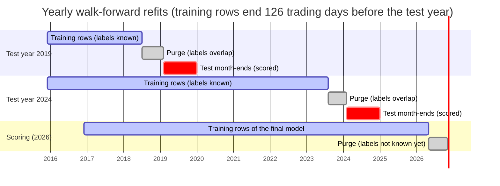
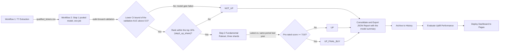
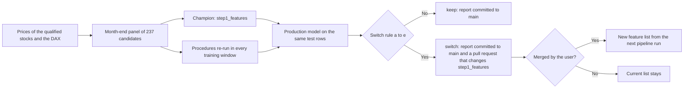

# Xetra Two-Step Stock Prediction
[](https://github.com/kleinnconrad/ml.prediction.stocks/actions/workflows/01_t7_download.yml)
[](https://github.com/kleinnconrad/ml.prediction.stocks/actions/workflows/02_run_pipeline.yml)
[](https://github.com/kleinnconrad/ml.prediction.stocks/actions/workflows/ci.yml)

## Table of Contents
- [How the Engine Works](#how-the-engine-works)
- [Paradigm Change in 3.0.0: From Per-Stock Models to One Pooled Model](#paradigm-change-in-300-from-per-stock-models-to-one-pooled-model)
- [Architecture Diagram](#architecture-diagram)
- [The variable set](#the-variable-set)
- [Quarterly Variable Review](#quarterly-variable-review)
- [Execution Guide](#execution-guide)
- [Configuration](#configuration)
- [Testing](#testing)
- [Dependency Management](#dependency-management)
- [Release Management](#release-management)
- [Directory Structure](#directory-structure)
- [Outputs & Diagnostics](#outputs--diagnostics)

A modular machine learning pipeline that ranks German Xetra (`.DE`) stocks by their estimated probability of a gain of at least 10% over the next 126 trading days (about 6 months). The stocks pass a two-step cascade: one pooled cross-sectional logistic regression ranks all stocks against each other (Step 1), and a deterministic ruleset on the latest financial statements checks the top-ranked stocks (Step 2).

> **Portfolio Hedging:** If you are looking for a way to hedge the portfolio generated by this engine, check out the companion repository: [](https://github.com/kleinnconrad/ml.prediction.depothedging)
>
> The companion repository reads `stock_name` and `final_prediction` from `data/processed/full_batch_report.json`; both fields are unchanged in release 3.0.0. From 3.0.0 the `UP_FINAL_BUY` stocks are drawn from the top 10% of the Step 1 ranking, so the list is longer than before (13 stocks in a test run on 2026-11-04, against 1 in the 2.x report of that day).

## How the Engine Works

The pipeline runs as scheduled GitHub Actions workflows:

1. **`1. T7 Download (Initialization)`** (weekly, Sundays 22:00 UTC): Downloads the list of all tradable Xetra instruments from Deutsche Börse and keeps common stocks (`Instrument Type == 'CS'`) whose `Product Assignment Group Description` is `DEUTSCHLAND`, `DAX`, `MDAX` or `SDAX`. This removes ETFs, ETNs, warrants and foreign listings and leaves about 420 domestic equities. No liquidity filter is applied. The list is committed to `data/state/qualified_tickers.csv`.
2. **`2. Execute Pipeline (Step 1 & 2)`** (daily, 01:00 UTC):
   - **Step 1 (Pooled Cross-Sectional Ranking, one runner):** One logistic regression, fitted on the history of all stocks, ranks the eligible stocks of the last closed trading day by their probability that the close 126 trading days later is at least 10% above the current close (point to point). The top 10% of the ranking (`step1_up_share`) are UP. A walk-forward validation is recomputed on every run; if it does not show a ranking skill (model gate), no stock is UP.
   - **Step 2 (Company Fundamentals, three parallel runners):** The UP stocks are checked against a deterministic ruleset on their latest financial statements. Passing stocks become buy candidates (`UP_FINAL_BUY`).
   - **Consolidation:** Merges the Step 2 shard outputs into the batch report together with the Step 1 model summary, archives it, evaluates the uplift of earlier predictions and commits the results.
3. **`Deploy Dashboard to GitHub Pages`**: Publishes the dashboard after every successful pipeline run.
4. **`5. Quarterly Variable Review`** (03:17 UTC on the 1st of February, May, August and November): Tests whether feature sets chosen by fixed selection procedures from a pool of 237 candidates rank the stocks better than the current `step1_features`. It commits a report and, only if the switch rule holds, opens a pull request that changes the feature list (see [Quarterly Variable Review](#quarterly-variable-review)).

### Step 1: Pooled Cross-Sectional Model (Machine Learning)
**Model:** Complete pooling: one L2-regularized logistic regression with one shared intercept and shared coefficients for all stocks (`C` = 0.1 (`step1_l2_c`), lbfgs solver with tolerance 1e-8 and at most 1000 iterations, no class weights). Partial pooling, with stock-specific deviations from the shared coefficients, was evaluated for this release and did not improve the validation; it is not implemented.

**Inputs:** The features in `step1_features` (see [The variable set](#the-variable-set)), each converted to its percentile rank among the eligible stocks of the same date, minus 0.5. The model therefore compares stocks with each other on a date; it does not forecast the direction of the market. An eligible stock without a value of a feature (for example, a 504-day feature of a stock with 300 trading days) gets the neutral rank 0, the rank of the median stock.

**Target:** A row is positive if the close 126 trading days later (`horizon_days`) is at least 10% (`threshold`) above the current close, point to point on adjusted closes.

**Eligibility:** A stock is ranked on a date if it has at least 253 own trading days up to that date (`step1_min_history_days`), its 126-day traded value is positive, its price is above €1 (`step1_min_price_eur`) and its last trade is at most 5 days old (`step1_ffill_limit_days`). The rule does not depend on the feature list, so a feature set with longer windows does not shrink the universe; for the default features it gives the same eligible stocks as requiring every feature, because their longest window needs 253 trading days. The price limit is separate from the €10 dashboard filter (`min_price_eur`).

**Training data:** The month-end rows (last trading day of each month) of all eligible stocks in the last 10 years (`step1_history_years`) whose 126-day forward return ended before the scoring date. The scoring date is the last closed trading day.

**UP rule:** The `n_up = min(n_ranked, max(1, floor(step1_up_share x n_ranked + 0.5)))` stocks with the highest probability are UP (`step1_up_share` = 0.10; ties are broken by ticker); all others are NOT_UP.

**Validation (walk-forward, purged) and model gate:**
* The test blocks are the last 8 calendar years (`step1_validation_years`) up to the year of the scoring date; the current year is a partial block. For each test year the model is refitted on the month-end rows of at most the 10 years (`step1_history_years`) before the year's first test month-end whose forward return ended before that date, so no training label overlaps the test period (126-trading-day purge).
* The download covers 12 years (`step1_history_years` + `feature_warmup_years`), and the features need the first year of it, so the refits of the early test years have fewer training years than the final model. In the test run of 2026-11-04, the 2019 refit used 32 month-ends (about 2.7 years) and the 2026 refit 113 (about 9.4 years).
* On every test month-end with at least 30 stocks (`step1_min_stocks_per_date`) and both classes, the cross-sectional ROC AUC measures how well the ranking separates the stocks that gained at least 10% from the others. The mean over all test dates is the validation AUC.
* Its 95% confidence interval comes from a moving-block bootstrap over the date series (blocks of 6 consecutive month-ends, `step1_bootstrap_block_months`; 2000 replications; seed 0), because the 126-day labels of neighboring month-ends overlap.
* **Model gate:** If the lower bound of the interval is at or below 0.5 (`step1_min_validation_auc_lower`), or the interval cannot be computed, no stock is UP on that day and every eligible stock carries the status `model_gate_failed`. The report key `step1_model.gate` states the reason. If no final model can be fitted (reason `no_training_rows` or `single_class_training`), no stock is ranked either: `n_ranked` and `n_up` are 0 and the scores are `null`.
* The summary also reports the share of dates with an AUC above 0.5, the hit rate of the top share against the base rate, the mean forward return of the top share minus the mean of all ranked stocks, and the in-sample against the out-of-sample AUC of the yearly refits.

Every stock with price data gets a `step1_model.status`:

| `status` | Meaning |
|---|---|
| `ok` | Ranked; the model gate passed. UP if the rank is within the top share. |
| `model_gate_failed` | The model gate failed: NOT_UP. The stock is ranked unless no final model could be fitted. |
| `not_eligible: insufficient_history` | Fewer than `step1_min_history_days` (253) own trading days up to the scoring date. |
| `not_eligible: price_at_or_below_min` | The price is at or below `step1_min_price_eur`. |
| `not_eligible: no_traded_value` | The 126-day traded value is zero. |
| `not_eligible: stale_price` | The last trade is more than `step1_ffill_limit_days` trading days old. |

#### Walk-Forward Validation Diagram


*(Each test year is scored by a model that was refitted on rows whose 126-day forward return ended before the year's first test month-end. The final model is fitted the same way up to the scoring date and ranks the stocks of the last closed trading day.)*

### Step 2: The Fundamental Ruleset Engine
Because historical fundamental data from Yahoo Finance is sparse, Step 2 does not use machine learning. It compares the company's **latest financial statement** with the statement for the **same period one year earlier** (365 ± 45 days, `step2_yoy_tolerance_days`), which removes seasonality and works for quarterly and half-yearly reporters alike. If no such statement exists, it falls back to the previous statement; `Comparison Basis` in the diagnostics records which was used.

**Scoring:** A rule whose inputs the company does not report (e.g. current assets and operating cash flow for banks and insurers) is *not applicable* and skipped. A company is evaluable if at least **5 rules** are applicable (`min_step2_applicable_rules`). It passes if it meets **7 out of 10** (`min_step2_score`), pro-rated to the applicable rules and rounded up: 7 of 10, 6 of 8, 4 of 5.

| # | Rule Name | Formula / Logic | Financial Rationale |
|---|---|---|---|
| 1 | **Revenue Growth** | `Total Revenue (Latest) > Total Revenue (Comparison)` | Ensures the company is actually growing its top-line sales. |
| 2 | **Profitability** | `Net Income (Latest) > 0` | The company must be currently profitable. |
| 3 | **Earnings Momentum** | `Net Income (Latest) > Net Income (Comparison)` | Bottom-line profits must be expanding. |
| 4 | **Cash Flow Health** | `Operating Cash Flow (Latest) > 0` | The core business operations must be generating positive cash. |
| 5 | **Quality of Earnings** | `Operating Cash Flow (Latest) > Net Income (Latest)` | A forensic accounting check. If paper profits exceed actual cash generated, earnings may be inflated by accruals. |
| 6 | **Free Cash Flow** | `Free Cash Flow (Latest) > 0` | The company generates surplus cash after capital expenditure. |
| 7 | **Margin Improvement** | `Operating Margin (Latest) > Operating Margin (Comparison)` | Revenue growth is only valuable if the cost to generate it is not rising faster. |
| 8 | **Liquidity** | `Current Assets / Current Liabilities > 1.2` | The current ratio (`min_current_ratio`). Ensures the company can cover short-term obligations. |
| 9 | **De-leveraging** | `Total Debt (Latest) < Total Debt (Comparison)` | Rewards companies that are paying down debt rather than accumulating leverage. |
| 10 | **ROE Proxy** | `Net Income / Stockholders Equity > 12% × period length / 365` | Capital efficiency of at least 12% annualized (`min_annual_roe`): 3% per quarter, 6% per half-year. Negative equity fails. |

---

## Paradigm Change in 3.0.0: From Per-Stock Models to One Pooled Model

Release 3.0.0 replaces the roughly 420 per-stock Step 1 models with one logistic regression fitted on all stocks together. It also drops the ANOVA pre-filter and the stepwise feature selection. This section explains:
- why the per-stock design had to be replaced;
- how a per-stock model, a pooled model and a partially pooled model work and how they differ;
- which tests decided the design, and why the stepwise selection was dropped;
- what the new Step 1 can and cannot do.

All numbers come from walk-forward tests over 2019-2026 that were run before the release. Their scripts and results are not part of the repository.

### Summary

| | Up to 2.x | From 3.0.0 |
|---|---|---|
| Models | One per stock (about 420) | One for all stocks |
| Training data per model | One stock's daily rows over 10 years (about 2,400 rows, about 20 independent 6-month outcomes) | All stocks' month-end rows over 10 years (about 38,000 rows, about 330-370 stocks per date) |
| Inputs | About 300-400 candidates, mostly macro series (FRED and Yahoo Finance) that take the same value for every stock on a date | 10 price and volume features of each stock, ranked against the other stocks on the same date |
| Feature selection | ANOVA pre-filter (40) and forward stepwise selection (12), separately per stock | None; a fixed, pre-specified feature set |
| Question answered | Is now a good time to own this stock? (timing) | Which stocks are more likely than the others to gain 10% over the next 126 trading days? (ranking) |
| UP decision | Per-stock KS cutoff plus gates (CV accuracy >= 65%, confusion-matrix rule) | Top 10% of the daily ranking, if the model passes its validation gate |
| Validation result | In-sample AUC 0.97, out-of-sample AUC 0.51 (no skill) | Out-of-sample cross-sectional AUC 0.56 [0.545, 0.575], equal to the in-sample value |

The target is unchanged: a stock is a positive case if its adjusted close 126 trading days after date t is at least 10% above its close at t (point to point). Step 2, the universe, the dashboard structure and the uplift evaluation are unchanged.

### Why the Per-Stock Design Had to Be Replaced

**1. The per-stock models were overfitted.**
- On a sample of 30 stocks, the fold models fitted their training rows closely but had no skill on the validation folds (median in-sample AUC 0.967 against out-of-sample AUC 0.508; AUC 0.5 is chance).
- In a control run the macro features were shifted in time, so that they carried no information about the target. The models fitted that noise equally well (in-sample AUC 0.943) and validated the same (out-of-sample difference -0.018, p = 0.53).
- Twelve pure calendar functions reproduced most of the training fit (in-sample AUC 0.948). The macro features worked as a clock that recognized the market phases of the training period.

**2. ANOVA and stepwise selection could not prevent this.**
- **Overlapping outcomes.** Consecutive days share most of their 6-month outcome window. The ~2,400 daily rows of a stock therefore contain only about 20 independent outcomes. The ANOVA F-test counts every row as independent and overstated significance about 50-fold: 78% of the features were "significant" at 5% on real data and 76% on the no-information control.
- **ANOVA prefers slow-moving series.** These fit a few market phases well; the central-bank balance sheets were frequently selected production features.
- **The stepwise selection graded itself on its own rows.** It compared about 400 candidate subsets on a noisy inner cross-validation and kept the winner. Its inner CV accuracy was 0.34 above that of a random subset, with no gain out of sample.
  - About a third of this optimism came from ANOVA being fitted on all rows of a fold, including the rows the inner cross-validation later used as test rows.
- **Too few outcomes for the number of parameters.** A model with 12 coefficients chosen from 300 candidates was fitted to about 20 independent outcomes, of which only 6-7 are gains of 10% or more. A common rule of thumb asks for at least 10 positive outcomes per coefficient (Peduzzi et al., 1996). Screening many candidates and refitting produces significant-looking fits even from noise (Freedman, 1983).
- **A defect.** When an inner training split contained a single class, every candidate subset scored as missing, and the selector took the first 12 ANOVA features in column order. This affected 109 of 352 validated production tickers in at least one fold.

**3. The production output was unstable.**
- Between 2026-10-09 and 2026-11-04, the set of stocks passing the gates changed from day to day by more than half (median overlap 36% between consecutive reports, each adding one trading day).
- Every one of the 113 tickers that passed at least once in that period also failed at least once.
- The only buy signal of 2026-11-04 came from models whose stepwise selection had fallen back to column order in both validation folds.

**4. Repairs within the per-stock design did not work.**
- These remedies narrowed the gap between training and validation:
  - stock-only features;
  - a small fixed feature set;
  - L1 or strong L2 regularization;
  - fast-moving features only;
  - monthly sampling.
- None of them produced out-of-sample skill that could be told apart from the no-information control. With two validation folds of about six independent outcomes each, the per-stock design cannot detect gains below about 0.07 AUC.

**5. Macro data showed no detectable 6-month timing skill, even for the index.**
- Run through the same protocol, the DAX itself had no out-of-sample timing skill from the macro features, neither in the 10-year window nor in a 26-year walk-forward (2000-2026, out-of-sample AUC 0.505).
- This does not prove that macro data carry no information. It shows that none could be detected or used reliably at this horizon and sample size.

### Three Ways to Fit One Model Across Many Stocks

There is one target variable in every design: "did stock i gain at least 10% in the 126 trading days after date t?". It is answered for every stock and date. The designs differ in whether the coefficients of the model are estimated separately for every stock or shared across stocks.

The following toy example uses two stocks, four month-ends each, and one feature: x = 1 if the stock had the higher 12-month momentum of the two that month.

| Row | Stock | Month | x (higher momentum) | y (gained at least 10%) |
|---|---|---|---|---|
| 1 | SAP | Jan | 1 | 1 |
| 2 | SAP | Feb | 1 | 1 |
| 3 | SAP | Mar | 0 | 0 |
| 4 | SAP | Apr | 0 | 1 |
| 5 | Bayer | Jan | 0 | 0 |
| 6 | Bayer | Feb | 0 | 0 |
| 7 | Bayer | Mar | 1 | 1 |
| 8 | Bayer | Apr | 1 | 0 |

**No pooling (one model per stock, the design up to 2.x).** Each stock has its own input matrix and its own model, `logit P(UP) = a_i + b_i * x`:

| Month | x | y |
|---|---|---|
| Jan | 1 | 1 |
| Feb | 1 | 1 |
| Mar | 0 | 0 |
| Apr | 0 | 1 |

*The input matrix of SAP; Bayer has its own.*

- SAP with high momentum gained in 2 of 2 cases (100%), with low momentum in 1 of 2 (50%). The fit pushes b_SAP toward infinity, because a share of 100% has no finite log-odds.
- Bayer with low momentum gained in 0 of 2 cases (0%), so a_Bayer goes toward minus infinity.
- Each model claims certainty from two rows. Fitting the models one at a time gives the same estimates as one regression on all rows in which every coefficient may differ by stock.

**Complete pooling (one model for all stocks, the design from 3.0.0).** The rows of all stocks are stacked into one input matrix, and one model `logit P(UP) = a + b * x` is fitted:

| Stock | Month | x | y |
|---|---|---|---|
| SAP | Jan | 1 | 1 |
| SAP | Mar | 0 | 0 |
| Bayer | Jan | 0 | 0 |
| Bayer | Mar | 1 | 1 |
| ... | | | |

- With high momentum, 3 of 4 rows gained (75%); with low momentum, 1 of 4 (25%).
- The logistic regression returns a = -1.10 and b = 2.20, which reproduce exactly these two shares.
- The stock column only labels the rows; it is not an input. Two stocks with the same inputs get the same probability, and different inputs give different probabilities.
- The per-stock rule of the earlier design already pooled across dates. One a_SAP and one b_SAP were estimated from all of SAP's days, on the assumption that the same rule holds on every date. Complete pooling makes the same assumption across stocks.
- Pooled cross-sectional models on characteristics ranked within each date are an established design in empirical finance (Gu, Kelly and Xiu, 2020).

**Partial pooling (a hierarchical or multilevel model).** The stacked matrix gets additional columns that identify the stock:

| Stock | Month | x | SAP | Bayer | x*SAP | x*Bayer | y |
|---|---|---|---|---|---|---|---|
| SAP | Jan | 1 | 1 | 0 | 1 | 0 | 1 |
| SAP | Mar | 0 | 1 | 0 | 0 | 0 | 0 |
| Bayer | Jan | 0 | 0 | 1 | 0 | 0 | 0 |
| Bayer | Mar | 1 | 0 | 1 | 0 | 1 | 1 |

- The coefficients of the `SAP` and `Bayer` columns adjust the shared intercept for each stock. The coefficients of `x*SAP` and `x*Bayer` adjust the shared slope.
- The fit pulls these adjustments toward zero. The pull is strong when a stock's own estimate is imprecise compared with how much the stocks' true effects differ, and weak when the stock's data determine its coefficient precisely.
- In the toy example SAP's own rows say 100% for high momentum and the shared rule says 75%. Partial pooling gives SAP a value in between, closer to 75%, because two rows are weak evidence.
- Complete pooling (the adjustments forced to zero) and no pooling (no pull, no shared columns) are the two limits of this model.

**How the designs differ.**

| | No pooling | Complete pooling | Partial pooling |
|---|---|---|---|
| Assumption | Effects are unrelated from stock to stock | Every feature has the same effect on the log-odds for every stock, with one shared intercept | Stock effects scatter around shared effects |
| Coefficients | One set per stock | One shared set | One shared set plus stock adjustments pulled toward zero |
| Data behind each coefficient | One stock's rows | All rows | All rows, plus the stock's own rows for its adjustment |
| Main risk | High variance: fitting noise when each stock has few independent outcomes | Bias if stocks follow different rules | Choosing the strength of the pull; needs enough data per stock to help |

The statistical basis of partial pooling is Stein's result (Stein, 1956; James and Stein, 1961). When three or more means are estimated together under squared-error loss, shrinking the separate estimates toward a common value by a suitable, data-determined amount gives a lower expected total error than the separate estimates. The gain is large when the true values are close together relative to the estimation noise. For logistic-regression coefficients the result holds only approximately. Gelman and Hill (2007, chapter 12) describe complete, no and partial pooling as the limits and the middle of one multilevel model.

### Evidence for Complete Pooling

All designs were scored on the same out-of-sample month-ends from 2019 to 2026:
- the same 10 features and the same training rows;
- a 126-trading-day purge between the training labels and the test dates;
- the per-date cross-sectional AUC as the metric, i.e. how well the model orders the stocks of one date against each other;
- confidence intervals from a block bootstrap over test dates.

| Design | Cross-sectional AUC, absolute target | Change against complete pooling [95% CI] |
|---|---|---|
| Complete pooling (implemented) | 0.561 [0.545, 0.575] | - |
| No pooling (one regularized model per stock, penalty chosen in hindsight on the test years) | 0.528 | -0.033 [-0.049, -0.020] |
| Partial pooling, strength of the pull chosen on training data only | 0.553 | -0.008 [-0.017, +0.001] |
| Stock-specific intercepts only | 0.555 | -0.007 [-0.014, +0.002] |
| Pooling within size or volatility groups | 0.550-0.560 | -0.011 to -0.002 |
| Fama-MacBeth (per-date fits, averaged) | 0.558 | -0.004 [-0.010, +0.002] |

- One model per stock was worse in every configuration tested and beat the pooled model in only 1 of 8 test years. In sample it reached AUC 0.69-0.78, against 0.52-0.53 out of sample, which is the overfitting pattern again.
- Partial pooling chose weaker stock adjustments as the training window grew, and none from 2024 on (absolute target). Any adjustment strong enough to matter lowered the out-of-sample AUC while raising the in-sample fit.
- Stock-specific deviations estimated on the years up to 2018 did not reappear in 2020-2026 (mean rank correlation across coefficients -0.01 to +0.00).

Stocks are not identical. There is a small, stable difference in each stock's base rate of reaching +10%. However, with about 20 independent 6-month outcomes per stock, such differences cannot be estimated precisely enough to improve the predictions. Pooled estimators often forecast better than heterogeneous ones even when homogeneity is rejected (Baltagi, Griffin and Xiong, 2000).

A power test planted realistic stock-specific momentum effects. Partial pooling did not detect them, and even exact knowledge of them changed the AUC by at most 0.005. The pooled model therefore does not show that all stocks behave alike. It shows that one shared rule predicts better than per-stock rules estimated from too little data.

### Why the Stepwise Feature Selection Was Dropped

Data-driven selection of predictors from a large set of candidates was a core element of the earlier design. It was tested in the pooled model before it was dropped.

The test compared the following on 53 stock-level candidates (returns over 5 to 252 days, momentum variants, trends, 52-week high and low, volatility, skewness, beta, idiosyncratic volatility, liquidity and Amihud illiquidity, among others; all point in time except the log price, which was later found to depend on later stock splits, see [Candidate Pool](#candidate-pool)):
- the 10 pre-specified features;
- the earlier ANOVA plus forward stepwise selection, done honestly:
  - re-run inside every training window;
  - with the ANOVA refitted inside each inner split;
  - with inner splits by date and a 126-day purge;
  - scored on the per-date cross-sectional AUC;
- lasso and elastic net, with the penalty chosen the same way;
- screening with a multiple-testing hurdle (Fama-MacBeth t > 3, Harvey, Liu and Zhu, 2016);
- stability selection;
- all 53 candidates without selection.

The selection step was repeated in every validation year, so the results include the optimism of the selection itself.

| Method | Cross-sectional AUC | Change against the 10 fixed features [95% CI] |
|---|---|---|
| 10 pre-specified features (implemented) | 0.561 | - |
| Honest ANOVA plus forward stepwise selection | 0.553 | -0.008 [-0.016, +0.005] |
| Elastic net over all 53 candidates | 0.565 | +0.004 [-0.003, +0.015] |
| All 53 candidates, no selection | 0.561 | -0.000 [-0.008, +0.012] |
| Stability selection (lasso) | 0.559 | -0.003 [-0.011, +0.009] |
| Earlier production-style selection on the stock-level candidates | 0.559 | -0.003 [-0.011, +0.007] |
| Earlier production-style selection with the macro candidates added | 0.500 | -0.061 |

**Why selection adds nothing here:**
- **The extra candidates fit only noise.** Using all 53 without selection gave exactly the AUC of the 10 fixed features, while the in-sample AUC rose from 0.566 to 0.586.
- **Stepwise selection picks noise.** A permutation test showed that the honest forward selection adds one or two pure-noise features in every year. Its optimism on noise equals its optimism on the real data. Only its first pick (the distance to the 52-week low) was above the noise range.
  - A stricter stopping rule stops after that single feature. A looser one moves toward the dense model.
- **The selected sets are unstable.** The share of features that two consecutive years have in common (Jaccard) was 0.25 for the earlier production-style procedure and 0.47 for the honest stepwise selection.
- **Macro candidates destroy the ranking.** With them in the candidate set, ANOVA and stepwise selection chose only macro features, in every year. Macro values are the same for every stock on a date, so the cross-sectional ranking fell to chance (0.500).
- **Elastic net is not a clear improvement.** It was the closest competitor, but its gain cannot be told apart from zero. The comparison can detect differences of about 0.013-0.018 AUC.

**What remains open:**
- The feature list is a setting (`step1_features`).
- Elastic net over a pre-registered set of stock-level candidates can be evaluated as a challenger on data after the release. It should replace the fixed set only if it gains more than about 0.015 AUC out of sample. The [Quarterly Variable Review](#quarterly-variable-review) runs this test every three months.
- Candidates from other data sources, such as fundamentals, were not part of the test.

### What the Pooled Model Does

Each daily run of Step 1 does the following:
1. Downloads adjusted daily prices (open, high, low, close) and volumes of all qualified stocks and the DAX index.
2. Computes 10 features per stock on its own trading days: returns over 21, 63 and 126 days, 12-month momentum without the last month (Jegadeesh and Titman, 1993), distances to the 50- and 200-day averages, volatility over 21 and 126 days, the log of the 126-day traded value, and the distance to the 52-week high.
3. Ranks each feature against the eligible stocks of the same date. A stock is eligible if it has traded on at least 253 days, its price is above EUR 1, its 126-day traded value is positive and its last trade is at most 5 days old.
4. Validates the model by yearly walk-forward refits over the last 8 years.
   - Each refit uses only training rows whose 126-day outcome ended before its test year begins, at most 10 years of them.
   - The download covers 12 years, so the refits of the first test years have fewer training years than the final model.
   - The model passes its gate if the lower bound of the 95% confidence interval of the mean per-date AUC is above 0.5.
5. Fits the final model on the month-end rows of the last 10 years whose outcome is known.
6. Scores the latest closed trading day and marks the top 10% of the ranking as UP, provided the gate passed. If the gate fails, no stock is UP, and the report says why.

**What "UP" means now.** UP means that the stock is among the 10% of stocks with the highest estimated probability of gaining 10% over the next 126 trading days. It is not a forecast that the stock will gain 10%. The model ranks stocks against each other on a date and has no skill at timing the market or a single stock.

In a falling market the top 10% can lose money, only less than the rest, or not even that. The model's probabilities are averaged over market conditions and are not calibrated for any single date.

### Expected Performance and Limitations

**Out-of-sample results of the walk-forward tests over 2019-2026, gross of costs:**
- **Cross-sectional AUC:** 0.561 [0.545, 0.575]. The run of 2026-11-04 gave 0.560 [0.542, 0.575]. It was above 0.5 on about 91-93% of the test dates.
- **Hit rate of the top 10%:** 40.8% of the top 10% gained at least 10%, against a base rate of 33.0% (+7.9 percentage points [4.5, 11.3]).
- **Average return of the top 10%:** 126-day return 7.0 percentage points above the universe mean [3.8, 10.5].
  - The median top-10% stock was only 0.5 percentage points above the universe mean. The average excess comes from a minority of large winners.
- **Fitting against plain momentum:** in liquid stocks (no stale prices, the 30% with the lowest traded value removed), the fitted model ranked no better than the 12-month momentum rank alone. Both beat the universe mean net of assumed trading costs, by about 4.4 percentage points per 126-day cohort (top 20%, equal weights).

**Limitations:**
- **Survivorship bias.** The data contain only stocks listed today. Delisted, merged and insolvent companies are missing. This can inflate both the base rate and the measured edge. Its size could not be measured without delisting data.
- **Adjusted price levels.** The closes are adjusted for splits and dividends (`auto_adjust=True` in yfinance), so a past close also reflects the splits and dividends after that date. Returns, moving-average distances, volatilities and the target are ratios of closes, in which this adjustment cancels out. Price levels do not: a later split divides all earlier closes by its ratio. The EUR 1 eligibility filter therefore compares past prices that depend on later splits and dividends. The traded value (close x volume) depends on later dividends only, because the volumes are adjusted for splits in the opposite direction. In a check on 59 stocks over 114 month-ends, the percentile of the traded value moved by 0.6 points on average (at most 8.7), with a rank correlation of at least 0.996. For the same reason, no price level is a candidate of the variable review (see [Candidate Pool](#candidate-pool)).
- **Reuse of the test period.** The years 2019-2026 were used for many design comparisons, so the figures above are not a clean holdout estimate. Live results after the release are the confirmatory test. Published return predictors also tend to weaken after publication.
- **Costs and liquidity.** Costs were modeled only as assumptions per liquidity group. The edge is weaker in the more liquid half of the market. A monthly rebalanced top-share portfolio trades several dozen orders per month, so fixed per-order fees matter for small portfolios.
- **Power.** The 126-day design can detect an AUC of about 0.52 against chance. Smaller effects, and small differences between designs, cannot be told apart from noise.
- **Display filter.** The dashboard hides stocks priced at or below EUR 10 (`min_price_eur`), while the ranking includes every stock above EUR 1 (`step1_min_price_eur`). Displayed ranks therefore have gaps.
- **Uplift history.** For up to six months after the release, the uplift report compares cohorts that mix per-stock reports (up to 2.x) with pooled reports. The return of the Step 1 top share is the count-weighted mean of the `UP` and `UP_FINAL_BUY` cohorts.

### How the Statistics Stay Honest

Pooling does not make rows independent. A stock's consecutive month-end outcomes overlap by about five of six months, and stocks on the same date share the market's move and sector moves. The design takes this into account as follows:
- **Purge.** A training row is used only if its 126-day outcome window ended before the test period starts, so no training label uses test-period prices.
- **Per-date scoring.** Each test date is scored by how well the model orders that date's stocks against each other. A forecast of the market's overall level earns no credit.
  - With the absolute +10% threshold, the market's move still decides how many stocks count as positives on a date. A model with a relative target (beating the date's median return) gave the same mean AUC.
- **Inference by blocks of dates.** Confidence intervals resample blocks of six consecutive month-end dates. A date with 370 stocks counts as one observation, and dates with overlapping outcomes stay in the same block. The 88 test dates carry about as much information as 15-30 independent observations.
  - This follows the logic of the Fama-MacBeth (1973) procedure: compute the statistic per date, then do the inference across dates.
- **Permutation control.** Shuffling the training outcomes between stocks within each date and refitting gave test AUCs between 0.45 and 0.55 over 50 shuffles. The observed 0.56 was above all of them.

### References

- Baltagi, B. H., Griffin, J. M. and Xiong, W. (2000). To pool or not to pool: Homogeneous versus heterogeneous estimators applied to cigarette demand. Review of Economics and Statistics 82(1), 117-126.
- Efron, B. and Morris, C. (1977). Stein's paradox in statistics. Scientific American 236(5), 119-127.
- Fama, E. F. and MacBeth, J. D. (1973). Risk, return, and equilibrium: Empirical tests. Journal of Political Economy 81(3), 607-636.
- Freedman, D. A. (1983). A note on screening regression equations. The American Statistician 37(2), 152-155.
- Gelman, A. and Hill, J. (2007). Data Analysis Using Regression and Multilevel/Hierarchical Models. Cambridge University Press, chapter 12.
- Gu, S., Kelly, B. and Xiu, D. (2020). Empirical asset pricing via machine learning. Review of Financial Studies 33(5), 2223-2273.
- Harvey, C. R., Liu, Y. and Zhu, H. (2016). ... and the cross-section of expected returns. Review of Financial Studies 29(1), 5-68.
- James, W. and Stein, C. (1961). Estimation with quadratic loss. Proceedings of the Fourth Berkeley Symposium 1, 361-379.
- Jegadeesh, N. and Titman, S. (1993). Returns to buying winners and selling losers: Implications for stock market efficiency. Journal of Finance 48(1), 65-91.
- Peduzzi, P. et al. (1996). A simulation study of the number of events per variable in logistic regression analysis. Journal of Clinical Epidemiology 49(12), 1373-1379.
- Stein, C. (1956). Inadmissibility of the usual estimator for the mean of a multivariate normal distribution. Proceedings of the Third Berkeley Symposium 1, 197-206.

---

## Architecture Diagram



---

## The variable set

Step 1 downloads the adjusted daily opens, highs, lows, closes and volumes of all qualified stocks in batches of 60 tickers (`price_download_batch_size`), covering the training window plus warm-up (`step1_history_years` + `feature_warmup_years` = 12 years). The DAX (`^GDAXI`, `market_index_ticker`) is downloaded with the batches; it is an input of the market-relative features of the registry, never a ranked stock, and it does not add days to the calendar of the stocks. Tickers that come back without data are requested again up to 3 times (`price_download_retries`); tickers without any data get no payload and are listed in `step1_model.cross_section.no_price_data`. The same price data feed the features, the eligibility and the target; no macroeconomic series are used.

### Step 1 Features (Price and Volume)
Every feature is computed per stock on the stock's own trading days (the days on which it has a close):

| Feature | Definition |
|---|---|
| `ret_21`, `ret_63`, `ret_126` | Return over 21, 63 and 126 trading days: `close[t] / close[t-k] - 1` |
| `mom_12_1` | 12-month momentum without the latest month: `close[t-21] / close[t-252] - 1` |
| `dist_sma50`, `dist_sma200` | Relative distance to the 50- and 200-day simple moving average: `close / SMA - 1` |
| `vol_21`, `vol_126` | Standard deviation of the daily returns over 21 and 126 trading days |
| `log_traded_value` | `ln(1 + mean(close x volume))` over 126 trading days; a missing volume counts as 0 |
| `drawdown_252` | Relative distance to the 252-day high: `close / max(close over 252 days) - 1` |

**Alignment:** The stocks' rows are placed on the union calendar of all downloaded trading days. A day without a trade carries the stock's last trading day for at most 5 days (`step1_ffill_limit_days`); after that the stock is not eligible (`stale_price`).

**Eligibility:** A stock is ranked on a date if it has at least 253 own trading days up to the date (`step1_min_history_days`), a positive 126-day traded value, a price above €1 (`step1_min_price_eur`) and a last trade at most 5 days old. The rule is the same for every feature list.

**Within-date ranks:** On every date, each feature of the eligible stocks is converted to its percentile rank among the eligible stocks that have a value (`rank(pct=True, method='average')` in pandas: ties share their average rank) minus 0.5, so every model input lies between -0.5 and 0.5 and a median stock has 0. An eligible stock without a value of a feature, or with a non-finite value, gets the neutral rank 0. The payload reports these positions as `feature_percentiles` (0 to 100; 50 for a missing value, whose raw value in the diagnostics is `null`) and the product of each coefficient and rank value as `logit_contributions`, the feature's contribution to the log-odds relative to a median stock (0 for a missing value).

**Feature list:** The model reads the list from `step1_features` in `config/settings.yaml` and computes only these features. Every name must exist in the feature registry (`FEATURE_FUNCTIONS` in `src/processing/features.py`): 237 features in 15 families, the candidate pool of the [Quarterly Variable Review](#quarterly-variable-review). Unknown names stop the run with an error. A list with market-relative features stops the run with an error if the DAX did not download. `step1_features_adopted` records the date on which the list was adopted. `docs/feature_engineering.sql` shows the computation of the 10 default features in SQL; `docs/generate_sql.py` has SQL templates only for these features, and the variable review does not regenerate the file.

### Step 2 Variables (Company Fundamentals)
If a stock reaches Step 2, its financial statements are read from the local cache (`data/raw/fundamentals/`) and filtered against a predefined `FUNDAMENTAL_UNIVERSE` so that only accounting rows enter the ruleset.

* **Income Statement:** Total Revenue, Operating Revenue, Gross Profit, Operating Income, EBIT, EBITDA, Net Income, Net Income Common Stockholders, Basic EPS, Diluted EPS.
* **Balance Sheet:** Total Assets, Current Assets, Total Liabilities (Net Minority Interest), Current Liabilities, Total Debt, Net Debt, Cash And Cash Equivalents, Stockholders Equity, Working Capital, Retained Earnings.
* **Cash Flow:** Operating Cash Flow, Investing Cash Flow, Financing Cash Flow, Free Cash Flow, Capital Expenditure, Repayment Of Debt, Issuance Of Debt.

### Additional Metrics (Dashboard Display)
The engine also extracts metrics that are shown on the dashboard but are not used by either step:

* **P/E Ratio (KGV):** $\text{P/E} = \frac{\text{Current Stock Price}}{\text{Earnings Per Share (EPS)}}$. A high P/E can mean that the price is high relative to earnings or that investors expect high growth; a low P/E can indicate a low price relative to earnings.
  * **Note on Dimensionality:** The P/E ratio is a point-in-time snapshot rather than a continuous, stationary time series and is only refreshed by Yahoo Finance from time to time. It is therefore not used as a predictor in Step 1.
* **Beta Factor:** $\beta = \frac{\text{Covariance}(R_s, R_m)}{\text{Variance}(R_m)}$. Volatility of the stock relative to the market. A beta greater than 1 indicates higher volatility than the market. This snapshot is not used as a predictor because of its collinearity with the stock's own volatility and its nature as a static snapshot. The candidate pool of the [Quarterly Variable Review](#quarterly-variable-review) contains betas computed from the downloaded prices (`beta_63` to `beta_504`); they are not part of the default `step1_features`.
* **Liquidity (Avg Daily Traded Value):** $\text{Liquidity (€M)} = \frac{\text{Average Daily Volume} \times \text{Latest Stock Price}}{1,000,000}$. An estimate of the average value traded per day. Low liquidity means that large orders can move the price (slippage); values below €0.5M are flagged. This snapshot is not used by either step; Step 1 computes its own traded-value feature from the downloaded prices and volumes (`log_traded_value`).

**Price filter:** Stocks priced at or below €10 (`min_price_eur`) are hidden from all KPIs and tables of the dashboard and excluded from the uplift evaluation, where a single illiquid penny stock could otherwise dominate a cohort average. The "Suppressed" KPI shows how many stocks are hidden and how many of them are buy candidates. The batch report and `final_buy_signals.csv` still include all stocks. The Step 1 ranking covers every stock above €1 (`step1_min_price_eur`), so the ranks shown on the dashboard (`rank / n_ranked`) have gaps.

---

## Quarterly Variable Review

Every three months, the workflow `5. Quarterly Variable Review` (`scripts/05_review_variables.py`, `src/modeling/variable_review.py`) checks whether a different feature set ranks the stocks better than the current `step1_features`. The current list is the champion. The challengers are the lists that fixed selection procedures choose from a pre-registered pool of 237 candidates. A challenger replaces the champion only if the switch rule holds, and only after the user merges the pull request that the workflow opens. Nothing switches without that merge.



### Why the Review Needs a Switch Rule

The tests before release 3.0.0 (study E6, see [Why the Stepwise Feature Selection Was Dropped](#why-the-stepwise-feature-selection-was-dropped)) set the conditions for a review:
- Honest stepwise selection from 53 candidates changed the cross-sectional AUC by -0.008 [-0.016, +0.005] against the 10 fixed features, and elastic net by +0.004 [-0.003, +0.015].
- The selected sets changed from year to year.
- With about 90 test dates, differences below about 0.015 AUC cannot be told apart from noise.

A review that compares several challengers on the same history every quarter would switch whenever one of them is ahead by chance. The pool and the procedures are fixed in advance, and the walk-forward comparison re-runs every selection inside each training window, so the comparison includes the optimism of the selection. What remains is the repeated look at the same history. The switch rule therefore asks for a minimum gain, an interval corrected for every comparison made on that history since the current list was adopted, a gain in at least 6 of the 8 test years, and fresh evidence that does not contradict.

### Candidate Pool

The pool is the content of the feature registry (`FEATURE_FUNCTIONS` in `src/processing/features.py`) at review time, unless `review_candidate_features` lists names. Every feature is computed per stock on its own trading days from trailing windows only. The inputs are the stock's open, high, low, close and volume and the close of the DAX (`^GDAXI`, `market_index_ticker`) on or before each of the stock's trading days. The pool contains 52 of the 53 candidates of E6 under their E6 names and definitions. The log price of E6 is left out because it is not point in time: the downloaded closes are adjusted for later splits, so a past price level depends on splits that happened after that date (see [Expected Performance and Limitations](#expected-performance-and-limitations)). On the month-end rows of the review data, the per-date AUC of the log price was 0.495 with adjusted closes and 0.510 with the closes of the time; the part of the adjustment due to later splits alone reached 0.483 [0.476, 0.490], because stocks that split later had often risen before. A missing or non-finite value is missing; in an eligible row it gets the neutral rank 0.

| Family | Features | Windows (trading days unless stated) |
|---|---|---|
| Returns | 10 | 1, 5, 10, 21, 42, 63, 84, 126, 189, 252 |
| Momentum with a skip window | 8 | 12-1, 12-2, 12-3, 9-1, 6-1, 3-1, 12-6 and 24-12 months (24-12 is the long-term reversal and needs 505 days) |
| Distance to the SMA | 7 | 10, 20, 50, 100, 150, 200, 250 |
| SMA crossovers | 8 | 5/20, 10/20, 10/50, 20/50, 20/100, 50/200, 20/200, 100/200 |
| SMA slopes | 8 | SMA 20 over 5 and 21 days; SMA 50, 100 and 200 over 21 and 63 days |
| Highs and lows | 29 | Distance to the high and to the low (10 to 504), position in the range (21 to 504), days since the high and the low (63 to 252), maximum drawdown and Ulcer index (63 to 252) |
| Volatility | 24 | Standard deviation of returns (5 to 252), downside and upside volatility (21 to 252), seven volatility ratios, volatility of the 21-day volatility (126 and 252) |
| Range-based volatility | 13 | Parkinson and Garman-Klass (10 to 126), mean (high - low) / close (5 to 126) |
| Higher moments | 20 | Skewness and kurtosis (21 to 252), largest and smallest daily return (5 to 252) |
| Market-relative (DAX) | 26 | Beta (63 to 504), correlation, idiosyncratic volatility, downside and upside beta, R-squared, residual momentum 12-1 and 6-1, return minus index return (5 to 252) |
| Liquidity and volume | 28 | Log traded value (5 to 252), Amihud illiquidity (10 to 252), share of zero-return and zero-volume days, volume trends, coefficient of variation of the volume |
| Trend quality | 20 | R-squared and t-statistic of a log-price trend (21 to 252), share of up days, information discreteness (63 to 252), return autocorrelation |
| Overnight and intraday | 8 | Mean overnight and intraday return (5 to 126) |
| Oscillators | 26 | RSI 7 to 28, stochastic %K 14 and 28 and %D 14, Williams %R 14, MACD line, signal and histogram (12/26/9, divided by the close), Bollinger %B and bandwidth (20, 50), CCI (20, 50), money flow index (14, 28), Chaikin money flow (21, 63), on-balance-volume slope (21 to 126), ADX (14, 28) |
| Seasonality | 2 | Return of the coming calendar month one and two years earlier |

The docstrings in `src/processing/features.py` define every family. Williams %R 14 and stochastic %K 14 differ by a constant and therefore have identical ranks.

### Selection Procedures

Each procedure maps the training rows of a window (month-end rows, within-date ranks, labels) to a feature list. The production model (L2 logistic regression, `step1_l2_c`) is then fitted on that list.

| Procedure | Selection |
|---|---|
| `stepwise` | The stepwise selection of releases up to 2.x, done honestly: inner validation blocks by date with a label-end purge, an ANOVA prefilter (`review_anova_k` = 40) refitted inside every inner training split, and forward selection on the mean per-date AUC of the validation blocks. It stops when no addition raises that AUC by at least 0.002 (`review_stepwise_min_gain`) or at 15 features (`review_max_features`). |
| `lasso` | L1 logistic regression over the whole pool (liblinear). The penalty is chosen from `review_lasso_c_grid` on the same inner splits by the mean per-date AUC of the production model refitted on the nonzero coefficients (relaxed lasso). At most 40 features are kept (`review_lasso_max_features`, the largest absolute coefficients); the report states when the limit applied. |
| `fm_screen` | Fama-MacBeth screening: the correlation of each candidate's rank with the label on every training date, kept if the absolute Newey-West t-statistic (6 lags, `review_fm_nw_lag`) of its mean exceeds 3.0 (`review_fm_t_hurdle`, Harvey, Liu and Zhu, 2016). |
| `all_candidates` | The whole pool without selection; a reference. |
| `manual:<name>` | Fixed lists from `review_manual_sets`; none by default. |

The inner splits are up to 3 expanding blocks (`review_inner_splits`) of 24 month-ends (`review_inner_validation_months`), each preceded by a label-end purge, with at least 12 inner training month-ends (`review_inner_min_train_months`). If even one block of 24 month-ends leaves fewer, a single shorter block is used. If `stepwise`, `lasso` or `fm_screen` select nothing, they return the champion list. All procedures are deterministic for given data and settings.

### Evaluation and Switch Rule

**Walk-forward:** The review uses the protocol of the production validation: yearly test blocks over the last 8 calendar years (`review_validation_years`) up to the year of the last trading day, training rows whose label ended before the first test date of the year, at most 10 years (`step1_history_years`) of them, and test rows with known labels. The champion keeps its list. Every challenger re-runs its procedure inside every training window, so the comparison includes the optimism of the selection itself. All lists are scored with the production model on exactly the same test rows. The final list of a procedure is its selection on the training rows of the production model on the review date.

**Per test date:** the cross-sectional AUC (dates with at least 30 stocks, `step1_min_stocks_per_date`), the hit rate of the top 10% (`step1_up_share`), the base rate and the mean forward return of the top share minus that of all ranked stocks.

**Paired comparison:** d = AUC of the challenger minus AUC of the champion on each test date.
- Historical: the mean d over all test dates with a moving-block bootstrap interval (`step1_bootstrap_*` settings) at the Bonferroni-corrected two-sided level 1 - 0.05 / m_cum (`review_family_alpha`; m_cum is explained below), and the mean d of every test year.
- Fresh: the test dates after `step1_features_adopted`. They did not exist when the champion and the procedures were fixed, so only they are a confirmatory test.
- Hit rate: the top-share hit rate of the challenger and of the champion, pooled over all test dates and over the fresh dates.

**Switch rule:** A challenger qualifies if all of these hold:

| Condition | Threshold |
|---|---|
| (a) Historical mean d | at least 0.015 (`review_auc_hurdle`) |
| (b) Lower bound of the historical interval at the level 1 - 0.05 / m_cum | above 0 |
| (c) Test years in which the mean d is positive | at least 6 (`review_min_winning_years`) of the test years that have test dates |
| (d) Fresh evidence | once 6 fresh test dates exist (`review_fresh_check_min_dates`): fresh mean d at least 0 and a fresh top-share hit rate not below the champion's. With fewer fresh dates the check is reported as not yet available and does not block a switch. |
| (e) Top-share hit rate on all test dates | not below the champion's |

Its final list must also differ from the champion. If several challengers qualify, the largest corrected lower bound wins (then the larger historical mean d, then the order of the procedures), and its final list is proposed. Otherwise the decision is keep, and the report lists the conditions each challenger failed, m_cum and the CI level. In the February and May reviews, the current calendar year has no test date with a known label yet, so (c) counts the 7 earlier test years.

**Accuracy of the corrected interval:** The interval is the percentile block bootstrap of the production validation (2000 replications, blocks of 6 month-ends). At the corrected levels it is approximate, and its coverage is lower than the nominal level. Its lower bound rests on a few replications (about the 12th smallest of 2000 at 98.75% and the 3rd at 99.69%), and all test dates of a year share one selected list and one refit, a dependence that is longer than the blocks. The hurdle (a), the stability condition (c) and the hit-rate condition (e) therefore carry part of the protection against noise. The table shows how often a challenger without a true gain met condition (b) alone and conditions (a) to (c) together in 4000 simulated series per row. Each series has 88 test dates in the layout of the test run (seven test years of 12 dates and one of 4), a true mean d of 0, the per-date spread of the test run, dates correlated over about three months and, in two rows, a random shift shared by all dates of a test year, as a selected list and a refit are:

| Simulated challenger | (b), m_cum = 4 | (a) to (c), m_cum = 4 | (b), m_cum = 16 | (a) to (c), m_cum = 16 |
|---|---|---|---|---|
| No year shift | 2.2% | 0.27% | 1.2% | 0.25% |
| Year shift as observed for `stepwise` (standard deviation 0.005) | 3.0% | 0.08% | 1.6% | 0.08% |
| Year shift as observed for `lasso` (standard deviation 0.013) | 4.3% | 1.1% | 2.6% | 0.9% |
| Nominal rate per comparison | 0.625% | 0.625% | 0.16% | 0.16% |

At m_cum = 4 the rule as a whole stays below the nominal rate except for the challenger with the largest year shift (1.1% against 0.625%). The hurdle (a) does not tighten with m_cum, so after several reviews a chance switch of such a challenger is up to about six times as likely as the correction states. A challenger without a true gain that passes by chance replaces the current list with one that ranks about as well on average. An interval with one observation per test year and t critical values (7 degrees of freedom) would hold the nominal rate. With the year-to-year spread of the four challengers of the test run, its lower bound would exceed 0 only above a mean gain of 0.009 to 0.023 AUC at m_cum = 4 and 0.012 to 0.030 at m_cum = 16, against the hurdle of 0.015.

### Repeated Reviews and the Earliest Switch

m_cum is the number of challenger comparisons made on the same history since the current list was adopted: the challengers of this review plus those of every earlier review dated after `step1_features_adopted`, counted from the committed reports in `data/processed/variable_reviews/`. A rerun on the same day replaces the report of the earlier run and is not counted twice. The first review with the 4 default challengers uses a 98.75% interval; after four quarterly reviews (16 comparisons) the interval is at 99.69%. Each further look at the same history therefore needs more evidence.
- **The first review can switch.** The first scheduled review, or a manual run right after the merge, can already switch if a challenger passes. Fresh test dates need 126 trading days to mature: the first one after the adoption on 2026-11-05 (the month-end of November 2026) has a known label in mid-2027, and condition (d) applies from the sixth one on.
- **Only clear gains switch.** Study E6 could detect differences of about 0.015-0.018 AUC at 80% power for a single comparison, and the evidence needed rises with m_cum.
- **A switch resets the count.** A switch moves `step1_features_adopted` to the review date, so the next review starts new counts of m_cum and of the fresh dates.

A test run on real data (review date 2026-11-05, prices up to 2026-11-04, m_cum = 4, 98.75% interval) gave a champion AUC of 0.560 [0.542, 0.575], equal to the production validation. No challenger was ahead: the mean d was -0.0115 for `stepwise`, -0.0053 for `lasso`, -0.0050 for `fm_screen` and -0.0163 for `all_candidates`, every corrected interval contained 0 or lay below it, and each challenger was ahead in at most 3 of the 8 test years. All four failed conditions (a), (b), (c) and (e); the fresh check was not yet available. The decision was keep.

### Outputs and Adoption

- **Report:** `data/processed/variable_reviews/review_YYYY-MM-DD.json` and `.md`, committed to `main` by the workflow (`chore: add variable review YYYY-MM-DD`). They contain the pool and its families, the lists selected per test year and the final lists, the AUC per year, the paired results with their intervals and the mean d per year, fresh evidence and hit rates, m_cum with the counted reports and the CI level, the decision with its reasons, the runtime, the peak memory and the parameters. The next reviews count these reports for m_cum.
- **Switch:** The script sets `step1_features` to the winner's final list and `step1_features_adopted` to the review date. It changes only these two lines of `config/settings.yaml`, so comments and key order are kept. The workflow commits this change to the branch `variable-review/YYYY-MM-DD` and opens a pull request (`feat(step1): adopt the variable set of the review of YYYY-MM-DD (<procedure>)`) whose body summarizes the evidence.
- **Adoption:** Merging the pull request adopts the list. The next run of `2. Execute Pipeline (Step 1 & 2)` uses it. Closing the pull request keeps the current list.
- **Output size:** The prediction payloads (`feature_percentiles`, `logit_contributions`), the feature diagnostics and the daily batch report, which is committed and archived, grow about linearly with the number of features. The pull request states the length of the current and the proposed list.
- **SQL reference:** `docs/feature_engineering.sql` documents the 10 default features and is not regenerated by the review. `docs/generate_sql.py` stops with an error for features without a SQL template in `FEATURE_SQL`.
- **CI on the pull request:** Pull requests and pushes made with the workflow's `GITHUB_TOKEN` do not start other workflows, so the `CI` workflow does not run on the review's pull request on its own. Close and reopen the pull request, or push a commit to its branch, to run the checks before merging.
- **Permissions:** The workflow needs `contents: write` and `pull-requests: write` and the repository setting that allows GitHub Actions to create pull requests (Settings, Actions, General, Workflow permissions). Release Please uses the same setting for its release pull requests.

### Running the Review Manually

- **GitHub Actions:** Actions, `5. Quarterly Variable Review`, Run workflow. A manual run commits its report and, on a switch, opens the pull request like a scheduled run. A second run on the same day replaces the report of the first. If the branch `variable-review/YYYY-MM-DD` of a switch already exists, the pull request step stops with an error; close that pull request and delete its branch before running the review again on the same day.
- **Local:** from the repository root, with `data/state/qualified_tickers.csv` present:
  ```bash
  uv run python scripts/05_review_variables.py --n-jobs 4 --price-cache data/price_cache
  ```
  | Option | Meaning |
  |---|---|
  | `--n-jobs` | Worker processes (default: the number of CPUs) |
  | `--price-cache DIR` | Reads the prices from CSV files in DIR if they exist, otherwise downloads them and writes them there (`data/` is not committed) |
  | `--candidates a,b,...` | Replaces the candidate pool, for tests |
  | `--review-date YYYY-MM-DD` | Review date (default: today in Europe/Berlin); prices from this date on are not used |
  | `--pr-body FILE`, `--commit-body FILE` | Where a switch writes the pull request body and the commit message body |
  | `--output-dir DIR` | Directory of the reports (default: `data/processed/variable_reviews`); the earlier reports in it are counted for m_cum |

  A local run that ends with a switch changes `config/settings.yaml` in the working tree.

The test runs on 4 cores took about 50 seconds from a price cache, plus about 40 seconds for the download of 12 years of prices; their processes together used at most about 3.5 GB of memory. The workflow stops after 60 minutes.

---

## Execution Guide

The engine can be executed from your local terminal or in the cloud via GitHub Actions. Local runs and the GitHub Actions scripts share the same Step 1, Step 2 and report code (`src/orchestration/steps.py`, `src/orchestration/report.py`) and produce the same outputs.

### 1. Local Terminal Execution
The `src/main.py` entry point acts as your local CLI.

* **Single-Ticker Mode (Diagnosis):**
  ```bash
  uv run python src/main.py --ticker SAP.DE
  ```
  A pooled model cannot be fitted on one stock. The run therefore reads the universe from `data/state/qualified_tickers.csv` (it stops with an error if the file is missing; run `scripts/01_run_t7.py` first), adds the ticker if it is not listed, fits and ranks the whole universe, and exports only this ticker's payload. The log states its position, for example `SAP.DE: rank 12 of 371, probability 0.41, UP (ok)`. Step 2 runs if the ticker is UP. No batch report is published.
* **Full Batch Mode:** Downloads and qualifies the T7 list, runs Step 1 for all qualified tickers and Step 2 for every UP ticker, and writes the same report (including the model summary), buy list and history archive as the cloud pipeline:
  ```bash
  uv run python src/main.py
  ```

API keys are read from a `.env` file in the repository root. Only `GEMINI_API_KEY` is used (company descriptions); without it, the descriptions come from `data/processed/company_profiles_cache.json` or a placeholder text.

### 2. Fundamental Data Caching (Important for Cloud)
Yahoo Finance blocks requests from GitHub Actions datacenters, so company fundamentals are fetched locally and committed as a cache.
* **Update the cache monthly** (on or after the 15th of each month) with your residential IP:
  ```bash
  uv run python scripts/update_fundamentals.py
  ```
* The script writes the CSV files in `data/raw/fundamentals/`, records the refresh date in `data/raw/fundamentals/_manifest.json` and updates the badge at the top of this README. Commit and push the changes; the cloud pipeline reads from this cache.
* The pipeline logs a warning when the cache is older than 45 days (`fundamentals_max_age_days`).

### 3. Cloud Execution (GitHub Actions)
The workflows run on their schedules. To run them manually from the "Actions" tab, use this order:

1. **`1. T7 Download (Initialization)`**: Fetches and commits the list of qualified `.DE` tickers.
2. **Fundamental Caching (manual step)**: Run `scripts/update_fundamentals.py` locally and push the cache (if it is not up to date).
3. **`2. Execute Pipeline (Step 1 & 2)`**: Runs Step 1 on one runner (`scripts/02_run_step1.py`), which uploads the UP list (`data/state/step1_passed.csv`) and all payloads plus the model summary, runs Step 2 on 3 runners, consolidates the results and commits them. The dashboard deployment starts automatically afterwards.

**`5. Quarterly Variable Review`** runs independently of this order (`scripts/05_review_variables.py`). It commits its report to `main` and, if the switch rule holds, opens a pull request that changes `step1_features`. See [Running the Review Manually](#running-the-review-manually) for a local run.

### Data Synchronization

The pipeline requires synchronized data retrieval to ensure reproducible predictions between local executions and cloud-based GitHub Actions. The engine standardizes the current date to the `Europe/Berlin` timezone and drops pricing data of the current calendar day. Only fully closed, historical trading candles are used; the scoring date of Step 1 is the last closed trading day.

> [!NOTE]
> Because the system drops the current day's live trading data, real-time prices during market hours will not influence the prediction until the subsequent calendar day.

---

## Configuration

All user-defined parameters are defined in `config/settings.yaml` and loaded through `config/settings.py`. The values used for a run are stored in each prediction payload (`applied_parameters`, a subset), in the model summary (`step1_model.parameters`) and in the batch report (`parameters`, all keys).

| Group | Keys |
|---|---|
| Target | `horizon_days`, `threshold` |
| Step 1 model | `step1_features`, `step1_features_adopted`, `step1_history_years`, `feature_warmup_years`, `step1_l2_c`, `step1_solver_tol`, `step1_max_iter`, `step1_up_share`, `step1_min_price_eur`, `step1_min_history_days`, `step1_ffill_limit_days` |
| Step 1 validation and gate | `step1_validation_years`, `step1_min_stocks_per_date`, `step1_bootstrap_block_months`, `step1_bootstrap_replications`, `step1_bootstrap_seed`, `step1_min_validation_auc_lower` |
| Price download | `price_download_batch_size`, `price_download_retries`, `market_index_ticker` |
| Quarterly variable review: pool and windows | `review_candidate_features`, `review_validation_years`, `review_inner_splits`, `review_inner_validation_months`, `review_inner_min_train_months` |
| Quarterly variable review: procedures | `review_anova_k`, `review_stepwise_min_gain`, `review_max_features`, `review_lasso_c_grid`, `review_lasso_max_features`, `review_lasso_seed`, `review_fm_t_hurdle`, `review_fm_nw_lag`, `review_manual_sets` |
| Quarterly variable review: switch rule | `review_auc_hurdle`, `review_family_alpha`, `review_min_winning_years`, `review_fresh_check_min_dates` |
| Step 2 ruleset | `min_step2_score`, `min_step2_applicable_rules`, `step2_yoy_tolerance_days`, `min_current_ratio`, `min_annual_roe`, `fundamentals_max_age_days` |
| Reporting | `history_retention_days`, `uplift_match_tolerance_days`, `min_price_eur` |
| Company profiles | `gemini_model` |
| Data source | `xetra_t7_url` |

The line items of the Step 2 financial statements (`FUNDAMENTAL_UNIVERSE`) are defined in `config/universe.py`. The variable review also reuses `step1_l2_c`, `step1_solver_tol`, `step1_max_iter`, `step1_min_stocks_per_date`, `step1_up_share` and the `step1_bootstrap_*` keys, and copies all parameters it used into its report.

---

## Testing

The offline unit tests in `tests/` cover the Step 1 features (hand-computed values, point-in-time behavior, labels and the label boundary), the candidate pool of the feature registry (every candidate computes, none looks ahead, a hand computation for every family, the default features unchanged), the eligibility rule and within-date ranks with the neutral rank of missing values, the variable review (inner splits and their purge, the selection procedures on a planted signal, the review panel against the production panel, the switch rule condition by condition, the count of earlier comparisons m_cum and the Bonferroni level, the settings update, the report and the workflow script on a synthetic price cache), the stop of a run whose market-relative features lack the market index, the walk-forward validation and its purge, the training window of the final model, the per-date AUC, the block bootstrap, the model gate, the top-share selection, the ineligibility statuses, a run without a final model, the payload schema, a planted signal and pure noise on synthetic universes, the price download (with a mocked yfinance, including the opens, highs, lows, the market index and the CSV price cache), the Step 2 ruleset, report consolidation, history pruning, the uplift evaluation and the JSON export. They use synthetic data and need no API keys or network access. The model parameters they rely on are pinned in `tests/conftest.py`, so a changed value in `config/settings.yaml` does not break them:
```bash
uv run pytest
```

`ruff check` enforces the rule groups E4, E7, E9 and F (pyflakes and the pycodestyle error rules, `[tool.ruff.lint]` in `pyproject.toml`). No formatter and no line-length limit are enforced.

The `CI` workflow (`.github/workflows/ci.yml`) runs the following checks on every pull request and on pushes to `main`:

| Job | Checks |
|---|---|
| `Lint` | `uv.lock` matches `pyproject.toml`; `ruff check`; `actionlint` (including `shellcheck`) on the workflow files; JavaScript syntax of `dashboard/app.js` |
| `Tests` | The unit tests on Python 3.12 and 3.14 |
| `Conventional Commits` | Every commit of a pull request follows the Conventional Commits format required by Release Please (pull requests only) |
| `CI passed` | Succeeds only if all jobs above succeeded or were skipped; use it as the single required status check in the branch protection of `main` |

Run the Python checks locally before pushing:
```bash
uv lock --check
uv run ruff check .
uv run pytest
```

---

## Dependency Management

The project uses [uv](https://docs.astral.sh/uv/) with a lockfile to guarantee reproducible builds.

* **Dependencies**: `pyproject.toml` declares the direct dependencies with exact versions; development tools (pytest, ruff) are in the `dev` dependency group.
* **Lockfile**: `uv.lock` pins the complete dependency tree. After changing `pyproject.toml`, run `uv lock` and commit both files. Never edit `uv.lock` manually.
* **Environment**: `uv sync` creates the virtual environment; `uv run <command>` runs a command in it. The GitHub Actions workflows use `uv run --locked`, which fails if `uv.lock` does not match `pyproject.toml`.
* **Automated Updates**: Dependabot updates the Python dependencies (`uv` ecosystem, updating `pyproject.toml` and `uv.lock` together) and the GitHub Actions, each grouped into a single weekly Pull Request.
* **Release 3.0.0**: The dependencies of the removed macro pipeline and per-stock charts (`pandas-datareader`, `matplotlib`, `seaborn` and `scipy` as a direct dependency; `scipy` stays installed through `scikit-learn`) were removed. Run `uv sync` once after updating an existing checkout, or let the next `uv run` synchronize the environment.

---

## Release Management

This repository uses [Google's Release Please](https://github.com/googleapis/release-please-action) to automate changelog generation, the creation of GitHub releases, and version bumps.

### How to trigger a release
Release Please is triggered automatically via GitHub Actions whenever code is pushed to the `main` branch. All commits must follow the **Conventional Commits** specification.

- **`feat:`** triggers a Minor version bump and adds the feature to the `CHANGELOG.md`.
- **`fix:`** triggers a Patch version bump and adds the bug fix to the `CHANGELOG.md`.
- **`feat!:` / `fix!:`** or a `BREAKING CHANGE:` footer triggers a Major version bump.
- **`chore:` / `ci:` / `docs:`** will not trigger a new release by themselves and do not appear in the changelog.

When a `feat:` or `fix:` commit is pushed to `main`, the bot opens a **Release Pull Request**. Once that PR is merged, the release is published and tagged, and the `CHANGELOG.md` and the version in `pyproject.toml` are updated on the `main` branch.

### Update uv.lock before merging a Release Pull Request
Release Please changes the version in `pyproject.toml` but not in `uv.lock`, which records the project's own version. Every workflow runs `uv run --locked`, so a release merged without a new `uv.lock` breaks CI and the next scheduled pipeline run. Before merging a Release Pull Request:
1. Check out its branch, run `uv lock` (only the `stock-predictor` version line changes) and check the result with `uv lock --check`.
2. Commit `uv.lock` as `chore: update uv.lock` and push it to the branch of the Release Pull Request.
3. Merge once the `CI passed` check succeeds. If Release Please updates the pull request again, repeat steps 1 and 2.

If a release was merged without this step, run `uv lock` on a branch from `main` and merge that commit before the next scheduled run of `2. Execute Pipeline (Step 1 & 2)`.

---

## Directory Structure

Here is the directory layout of the repository and what you can find in each folder:

- **`.devcontainer/`**: Devcontainer configuration (Python 3.12, uv) for reproducible development environments in VS Code or GitHub Codespaces.
- **`.github/`**: GitHub Actions workflows (T7 download, pipeline, dashboard deployment, quarterly variable review `05_review_variables.yml`, CI checks, Release Please) and the Dependabot configuration.
- **`config/`**: Parameters (`settings.yaml`), the settings loader (`settings.py`) and the Step 2 line items (`universe.py`).
- **`dashboard/`**: HTML/JS/CSS of the dashboard deployed to GitHub Pages.
- **`data/`**: Data artifacts at various stages of processing:
  - `data/raw/`: The Xetra T7 dump and the fundamentals cache (`fundamentals/`, including `_manifest.json`).
  - `data/state/`: State passed between pipeline steps: `qualified_tickers.csv` (committed) and `step1_passed.csv` (the Step 1 UP tickers; created in the pipeline run and passed to Step 2 as an artifact, not committed).
  - `data/processed/`: Published outputs (`full_batch_report.json`, `final_buy_signals.csv`, `uplift_report.json`, `company_profiles_cache.json`, `history/`) and the reports of the quarterly variable review (`variable_reviews/review_YYYY-MM-DD.json` and `.md`, committed by the review workflow).
- **`docs/`**: Reference documentation: the SQL translation of the feature engineering of the 10 default Step 1 features, the eligibility and the within-date ranks (`feature_engineering.sql`, generated by `generate_sql.py`, which has SQL templates for these features only; the variable review does not regenerate it).
- **`logs/`**: Local log files written by `src/main.py`.
- **`outputs/`**: Outputs of a run (not committed):
  - `outputs/predictions/`: Full prediction payloads per ticker.
  - `outputs/diagnostics/`: Feature diagnostics per ticker, the Step 1 model summary (`step1_model_summary.json`) and the per-date validation table (`step1_validation_per_date.csv`).
  - `outputs/matrices/`: Fundamentals used by Step 2 per ticker.
- **`scripts/`**: Entry point scripts for the GitHub Actions runners (`01_run_t7.py`, `02_run_step1.py`, `03_run_step2.py`, `04_consolidate.py`, `05_review_variables.py` for the quarterly variable review) and maintenance scripts (`update_fundamentals.py`, `generate_dummy_uplift_data.py`).
- **`src/`**: The core application logic:
  - `main.py`: Local CLI entry point.
  - `src/ingestion/`: API connectors (Yahoo Finance batch prices with the market index and the CSV price cache, fundamentals, Xetra T7, Gemini).
  - `src/processing/`: Ticker qualification, the feature registry (the Step 1 features and the candidate pool of the variable review), eligibility and within-date ranks, and the uplift evaluation.
  - `src/modeling/`: The Step 1 pooled cross-sectional model with its walk-forward validation and gate, the quarterly variable review (`variable_review.py`: selection procedures, paired comparison, switch rule, report and settings update), and the Step 2 (Company Fundamentals) ruleset.
  - `src/orchestration/`: Step 1 and Step 2 runners, report consolidation, JSON export and the local batch runner.
- **`tests/`**: Offline unit tests (pytest) and their synthetic-data fixtures (`conftest.py`), including the tests of the feature registry (`test_feature_registry.py`), the variable review (`test_variable_review.py`) and its workflow script (`test_review_script.py`).

---

## Outputs & Diagnostics

The engine generates the following outputs:
1. **`outputs/predictions/{ticker}_prediction.json`**: The full payload of a stock with price data: company profile, latest price (last close of the price panel), P/E, beta, liquidity, the applied parameters, the Step 1 entry `step1_model` (`status`, `predicted_class`, `probability`, `rank`, `n_ranked`, `top_percent`, `up_share`, `n_up`, `scoring_date`, `feature_percentiles` and `logit_contributions`; the score fields are `null` for stocks that are not ranked; a feature without a value enters the model at the neutral rank, shown as percentile 50 with contribution 0) and, after Step 2, the ruleset diagnostics and the final prediction (`NOT_UP`, `UP` or `UP_FINAL_BUY`). Ineligibility and a failed model gate appear only in `step1_model.status`; `final_prediction` keeps its three values.
2. **`outputs/diagnostics/{ticker}_feature_diagnostics.json`**: The raw feature values (`null` if missing) and percentiles of the scoring date (`step1_pooled`) and the rule-by-rule Step 2 results (`step2_funds`).
3. **`outputs/diagnostics/step1_model_summary.json`** and **`outputs/diagnostics/step1_validation_per_date.csv`**: The model summary (scoring date, features, coefficients and intercept, training rows, cross-section counts, validation per year and overall with the bootstrap CI, gate, parameters) and the validation metrics per test date. The summary travels with the Step 2 artifacts to the consolidation.
4. **`data/processed/full_batch_report.json`**: All prediction payloads of a run with the execution date, the parameters and the model summary (`step1_model`). Model-level metrics are stored only here, not in each payload. It feeds the dashboard.
5. **`data/processed/final_buy_signals.csv`**: The tickers that passed both Step 1 and Step 2 (`UP_FINAL_BUY`).
6. **`data/processed/history/YYYY-MM/report_YYYY-MM-DD.json`**: Daily archive of the batch report. Reports older than 200 days (`history_retention_days`, based on the date in the file name) are removed automatically.
7. **`data/processed/uplift_report.json`**: Backtest of earlier predictions. For the archived reports closest to 1, 3 and 6 months ago (within 15 days), it measures the return of every stock from the first close on or after the report date to the latest close and averages it per cohort (`UP_FINAL_BUY`, `UP`, `NOT_UP`) and over all stocks (`baseline`). Stocks priced at or below `min_price_eur` (€10) at the time of the prediction are excluded from all cohorts, as on the dashboard; `excluded_below_min_price` holds their number. Empty cohorts are `null`; `counts` holds the cohort sizes. This feeds the uplift charts on the dashboard. Until the archive covers 6 months of 3.0.0 reports, the windows include reports of the earlier per-stock models.
8. **`data/processed/company_profiles_cache.json`**: Cached company descriptions generated with the Gemini API, committed by the pipeline so that only new tickers are requested.
9. **`data/processed/variable_reviews/review_YYYY-MM-DD.json`** and **`.md`**: The reports of the quarterly variable review (decision and reasons, champion, paired comparison, AUC per year, selected lists, candidate pool, runtime, peak memory and parameters; see [Outputs and Adoption](#outputs-and-adoption)).

Copyright (c) 2026 Conrad Kleinn. All rights reserved.
