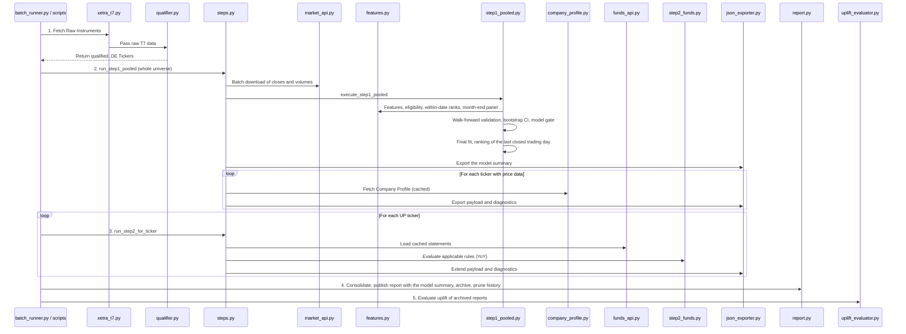

# Source Code Documentation (`src/`)

## Table of Contents
- [Runtime View](#runtime-view)
- [1. `ingestion/`](#1-ingestion)
- [2. `processing/`](#2-processing)
- [3. `modeling/`](#3-modeling)
- [4. `orchestration/`](#4-orchestration)

This directory contains the codebase of the Xetra Two-Step Stock Prediction Engine. The architecture is split into four layers: Ingestion, Processing, Modeling, and Orchestration. Parameters are read from `config/settings.yaml` through `config/settings.py`.

## Runtime View

The local CLI (`batch_runner.py`) and the GitHub Actions scripts (`scripts/02_run_step1.py`, `scripts/03_run_step2.py`, `scripts/04_consolidate.py`) use the same Step 1 and Step 2 runners in `steps.py` and the same consolidation in `report.py`. Step 1 runs once for the whole universe; Step 2 runs per UP ticker.

Below is a breakdown of every folder and the responsibilities of each script.

---

## 1. `ingestion/`
Responsible for extracting data from external APIs (Yahoo Finance, Xetra, Gemini).

* **`xetra_t7.py`**: Downloads and parses the Xetra T7 `allTradableInstruments.csv` from the Deutsche Börse network, extracting the raw universe of tradable securities.
* **`market_api.py`**: `fetch_price_panel()` downloads the adjusted daily closes and volumes of all tickers in batches (`price_download_batch_size`), re-downloads tickers that came back without data (`price_download_retries`, exponential backoff with jitter), drops the rows of the current Europe/Berlin day and returns a `PricePanel` (closes and volumes on the union calendar plus the tickers without data).
* **`funds_api.py`**: Returns the financial statements of a ticker from the local cache (`data/raw/fundamentals/`), falling back to Yahoo Finance, filtered to the `FUNDAMENTAL_UNIVERSE`. It warns when the cache manifest shows that the cache is older than `fundamentals_max_age_days`.
* **`company_profile.py`**: Uses the Gemini API (model `gemini_model` in `config/settings.yaml`) to generate a one-sentence description for a ticker. Results are cached in `data/processed/company_profiles_cache.json`, which the pipeline commits, so only new tickers are requested.

## 2. `processing/`
Responsible for qualifying the universe, building the Step 1 inputs and evaluating past predictions.

* **`qualifier.py`**: Filters the raw Xetra dataframe to common stocks of the product groups `DEUTSCHLAND`, `DAX`, `MDAX` and `SDAX` and maps their mnemonics to Yahoo Finance `.DE` tickers. No liquidity filter is applied; the per-date eligibility of Step 1 is applied in `features.py`.
* **`features.py`**: The feature registry (`FEATURE_FUNCTIONS`: returns over 21/63/126 days, 12-1 momentum, distance to the 50- and 200-day SMA, 21- and 126-day volatility, log traded value, 252-day drawdown), computed per stock on its own trading days together with the forward return over `horizon_days` and its end date. `build_feature_panel()` aligns all stocks on the union calendar (carrying a stock for at most `step1_ffill_limit_days`) and marks the eligible cells (features present, positive traded value, price above `step1_min_price_eur`); `rank_within_date()`, `month_end_dates()` and `to_long_panel()` build the ranked month-end panel with the binary target.
* **`uplift_evaluator.py`**: Backtests the archived reports closest to 1, 3 and 6 months ago by measuring each stock's return from the report date and averaging it per prediction cohort. Stocks priced at or below `min_price_eur` are excluded, as on the dashboard. Run with `uv run python -m src.processing.uplift_evaluator`.

## 3. `modeling/`
Houses the Step 1 model, its validation and the fundamental ruleset.

* **`step1_pooled.py`**: Executes Step 1 (`execute_step1_pooled()`): one L2 logistic regression with shared coefficients for all stocks (`fit_pooled_model()`), the yearly walk-forward validation with a 126-day purge (`walk_forward_validation()`), the per-date cross-sectional AUC (`per_date_auc()`), the moving-block bootstrap CI (`block_bootstrap_ci()`), the model gate (`evaluate_gate()`) and the ranking of the scoring date with the top-share UP rule (`score_cross_section()`). It returns the per-ticker results, the model summary and the validation, and builds the per-ticker `step1_model` entries.
* **`step2_funds.py`**: Implements the deterministic Fundamental Rules Engine. It compares the latest statement with the same period one year earlier (falling back to the previous statement), skips rules whose inputs are not reported, and passes companies that meet the pro-rated `min_step2_score` on at least `min_step2_applicable_rules` applicable rules.

## 4. `orchestration/`
The control layer that manages execution flow and artifact storage.

* **`steps.py`**: `run_step1_pooled()` (download, model, export of the model summary and of one payload per ticker with price data; with `only_tickers`, only those payloads are exported) and `run_step2_for_ticker()`, shared by the local CLI and the GitHub Actions scripts, plus the readers and writers of `data/state/qualified_tickers.csv` and `data/state/step1_passed.csv`. Step 2 extends the Step 1 payload and diagnostics instead of replacing them.
* **`report.py`**: Consolidates the shard outputs into one payload per ticker, writes `full_batch_report.json` (with the model summary as `step1_model`) and `final_buy_signals.csv`, archives the report, prunes the history by report date and updates the company profile cache.
* **`batch_runner.py`**: The local CLI flow. `run_batch()` qualifies the tickers, runs Step 1 once for all of them, Step 2 for every UP ticker, and publishes the report with `report.py`. `run_single()` ranks the universe of `data/state/qualified_tickers.csv` and exports one ticker.
* **`json_exporter.py`**: Serializes payloads, diagnostics and the model summary. It converts numpy types and non-finite floats (to `null`) and replaces files atomically, so a failed write never truncates an existing file.
* **`logging_setup.py`**: Configures logging for the CLI and the scripts.
