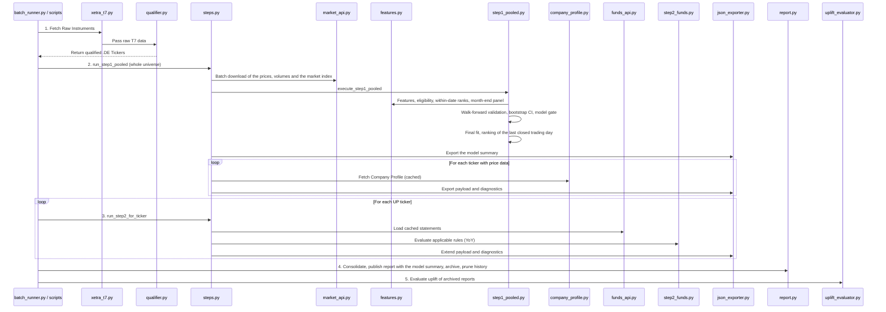
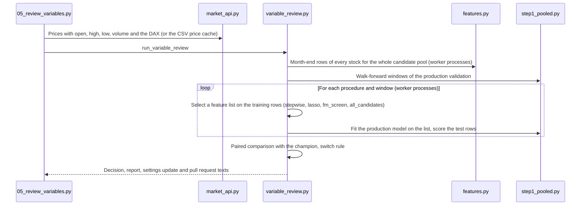

# Source Code Documentation (`src/`)

## Table of Contents
- [Runtime View](#runtime-view)
- [1. `ingestion/`](#1-ingestion)
- [2. `processing/`](#2-processing)
- [3. `modeling/`](#3-modeling)
- [4. `orchestration/`](#4-orchestration)

This directory contains the codebase of the Xetra Two-Step Stock Prediction Engine. The architecture is split into four layers: Ingestion, Processing, Modeling, and Orchestration. Parameters are read from `config/settings.yaml` through `config/settings.py`.

## Runtime View

The local CLI (`batch_runner.py`) and the GitHub Actions scripts (`scripts/02_run_step1.py`, `scripts/03_run_step2.py`, `scripts/04_consolidate.py`) use the same Step 1 and Step 2 runners in `steps.py` and the same consolidation in `report.py`. Step 1 runs once for the whole universe; Step 2 runs per UP ticker. The quarterly variable review (`scripts/05_review_variables.py`) is a separate flow, shown in the second diagram.

Below is a breakdown of every folder and the responsibilities of each script.

---

## 1. `ingestion/`
Responsible for extracting data from external APIs (Yahoo Finance, Xetra, Gemini).

* **`xetra_t7.py`**: Downloads and parses the Xetra T7 `allTradableInstruments.csv` from the Deutsche Börse network, extracting the raw universe of tradable securities.
* **`market_api.py`**: `fetch_price_panel()` downloads the adjusted daily opens, highs, lows, closes and volumes of all tickers in batches (`price_download_batch_size`) together with the market index (`market_index_ticker`), re-downloads tickers that came back without data (`price_download_retries`, exponential backoff with jitter), drops the rows of the current Europe/Berlin day and returns a `PricePanel` (the price fields on the union calendar of the stocks, the index closes and the tickers without data). `save_price_panel()` and `load_price_panel()` store a panel as CSV files (the `--price-cache` of the variable review).
* **`funds_api.py`**: Returns the financial statements of a ticker from the local cache (`data/raw/fundamentals/`), falling back to Yahoo Finance, filtered to the `FUNDAMENTAL_UNIVERSE`. It warns when the cache manifest shows that the cache is older than `fundamentals_max_age_days`.
* **`company_profile.py`**: Uses the Gemini API (model `gemini_model` in `config/settings.yaml`) to generate a one-sentence description for a ticker. Results are cached in `data/processed/company_profiles_cache.json`, which the pipeline commits, so only new tickers are requested.

## 2. `processing/`
Responsible for qualifying the universe, building the Step 1 inputs and the candidate pool, and evaluating past predictions.

* **`qualifier.py`**: Filters the raw Xetra dataframe to common stocks of the product groups `DEUTSCHLAND`, `DAX`, `MDAX` and `SDAX` and maps their mnemonics to Yahoo Finance `.DE` tickers. No liquidity filter is applied; the per-date eligibility of Step 1 is applied in `features.py`.
* **`features.py`**: The feature registry (`FEATURE_FUNCTIONS`, 237 features in 15 families listed in `FEATURE_FAMILIES`): the Step 1 features and the candidate pool of the variable review. No price level is registered, because the adjusted closes of past dates depend on later splits. Each feature function takes a `StockSeries` (close, volume, open, high and low on the stock's own trading days and the market index carried to those days) and is computed together with the forward return over `horizon_days`, its end date and the number of own trading days (`stock_feature_frame()`). `build_feature_panel()` computes only the requested features (and stops with an error if market-relative features are requested without the market index, `check_market_index()`), aligns all stocks on the union calendar (carrying a stock for at most `step1_ffill_limit_days`) and marks the eligible cells with a rule that does not depend on the features (`eligible_rows()`: at least `step1_min_history_days` own trading days, positive traded value, price above `step1_min_price_eur`, not stale). `rank_within_date()`, `month_end_dates()` and `to_long_panel()` build the ranked month-end panel with the binary target; an eligible stock without a value gets the neutral rank 0. `stock_panel_rows()` and `rank_long_panel()` build the same panel per stock without wide frames, for the whole pool of the variable review.
* **`uplift_evaluator.py`**: Backtests the archived reports closest to 1, 3 and 6 months ago by measuring each stock's return from the report date and averaging it per prediction cohort. Stocks priced at or below `min_price_eur` are excluded, as on the dashboard. Run with `uv run python -m src.processing.uplift_evaluator`.

## 3. `modeling/`
Houses the Step 1 model, its validation, the quarterly variable review and the fundamental ruleset.

* **`step1_pooled.py`**: Executes Step 1 (`execute_step1_pooled()`): one L2 logistic regression with shared coefficients for all stocks (`fit_pooled_model()`), the yearly walk-forward validation with a 126-day purge (`walk_forward_validation()`, whose windows `walk_forward_windows()` also defines for the variable review), the per-date cross-sectional AUC (`per_date_auc()`), the moving-block bootstrap CI (`block_bootstrap_ci()`), the model gate (`evaluate_gate()`) and the ranking of the scoring date with the top-share UP rule (`score_cross_section()`). It returns the per-ticker results, the model summary and the validation, and builds the per-ticker `step1_model` entries.
* **`variable_review.py`**: The quarterly champion-challenger review of the feature set (`run_variable_review()`). It builds the long panel of the candidate pool (`build_review_panel()`), runs the selection procedures `stepwise` (honest forward selection with per-split ANOVA prefilter), `lasso` (relaxed L1), `fm_screen` (Newey-West t hurdle), `all_candidates` and the manual lists inside every walk-forward window with nested, purged inner splits (`inner_date_splits()`), scores every list with the production model on the same test rows, compares each challenger with the champion (`compare_to_champion()`: paired per-date AUC differences, their mean per test year, a block-bootstrap interval at the Bonferroni level 1 - `review_family_alpha` / m_cum, fresh dates, hit rates) and applies the switch rule (`evaluate_switch_rule()`). m_cum counts the challenger comparisons since the champion was adopted, from the committed reports of the earlier reviews (`earlier_comparisons()`, `multiple_testing_correction()`). It also builds the JSON and markdown reports, the pull request and commit texts, and the two-line settings update (`update_settings_text()`). The procedures and the per-stock features run in worker processes (`--n-jobs`).
* **`step2_funds.py`**: Implements the deterministic Fundamental Rules Engine. It compares the latest statement with the same period one year earlier (falling back to the previous statement), skips rules whose inputs are not reported, and passes companies that meet the pro-rated `min_step2_score` on at least `min_step2_applicable_rules` applicable rules.

## 4. `orchestration/`
The control layer that manages execution flow and artifact storage.

* **`steps.py`**: `run_step1_pooled()` (download, model, export of the model summary and of one payload per ticker with price data; with `only_tickers`, only those payloads are exported) and `run_step2_for_ticker()`, shared by the local CLI and the GitHub Actions scripts, plus the readers and writers of `data/state/qualified_tickers.csv` and `data/state/step1_passed.csv`. Step 2 extends the Step 1 payload and diagnostics instead of replacing them.
* **`report.py`**: Consolidates the shard outputs into one payload per ticker, writes `full_batch_report.json` (with the model summary as `step1_model`) and `final_buy_signals.csv`, archives the report, prunes the history by report date and updates the company profile cache.
* **`batch_runner.py`**: The local CLI flow. `run_batch()` qualifies the tickers, runs Step 1 once for all of them, Step 2 for every UP ticker, and publishes the report with `report.py`. `run_single()` ranks the universe of `data/state/qualified_tickers.csv` and exports one ticker.
* **`json_exporter.py`**: Serializes payloads, diagnostics and the model summary. It converts numpy types, non-finite floats (to `null`) and dates (to ISO text) and replaces files atomically, so a failed write never truncates an existing file.
* **`logging_setup.py`**: Configures logging for the CLI and the scripts.
